import PremiumNote from '/snippets/premium-note.mdx';

<Note>
  BrewBot for iOS is in **beta**. Features, screens, and behavior may change between builds. Report problems in the [support Discord](https://discord.gg/WbMUYr7DCg).
</Note>

<PremiumNote />

BrewBot for iOS turns your iPhone or iPad into a [TikTok](/features/tts) or [Twitch](/features/twitch-tts) TTS player. You can play chat messages on a second device while you run your stream on another one. You can also change your voice, message rules, and audience, start and stop the [speed dating](/features/speed-tracker) timer, manage your [Brewlinks](/features/brewlinks) pages, and read your [BrewForms](/features/brewforms) responses, without opening the dashboard.

The app needs iOS 17 or later. It works on iPhone and iPad, including iPhone Duo.

The beta covers TTS, the speed dating timer, Brewlinks, and reading BrewForms responses. Use the [dashboard](https://brewbot.gg) for everything else, including adding TikTok channels, connecting Twitch accounts, and building forms.

## Get the beta

The beta is available through TestFlight. To get an invite, contact support in the [support Discord](https://discord.gg/WbMUYr7DCg).

## Before you start

- Sign in to the [dashboard](https://brewbot.gg) at least once, so your servers and teams are set up.
- Choose a source for the platform you want to play. For TikTok, add a channel in [TikTok Chat Monitor](/features/live-monitor). For Twitch, add a source in [Twitch TTS](/features/twitch-tts#connect-a-source).
- Make sure the server has premium. On team servers, TikTok TTS and **Default voice** also need server admin access or the **Speed Dating** [feature permission](/getting-started/teams#feature-permissions).

## Sign in

Open the app and select **Sign in to BrewBot**. Use the same email or Discord sign-in you use on the dashboard. You don't need a separate account.

<Frame>
  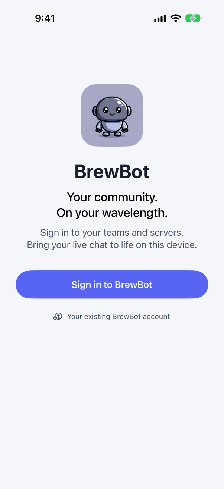
  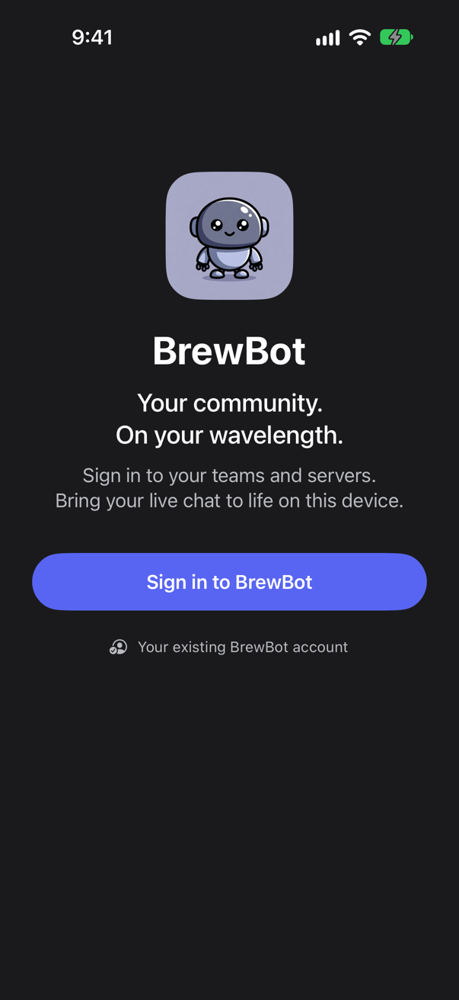
</Frame>

## Find your server

**Your servers** lists every server you can access, grouped by personal workspace and team. Each server shows whether the bot is connected or offline.

- Select the workspace button at the top left to show **All servers**, only **Personal**, or a single team.
- Use **Find a server** to search by name.
- Pull down on the list to refresh it.

Choosing a workspace only filters the list. It doesn't change what you can access.

<Frame>
  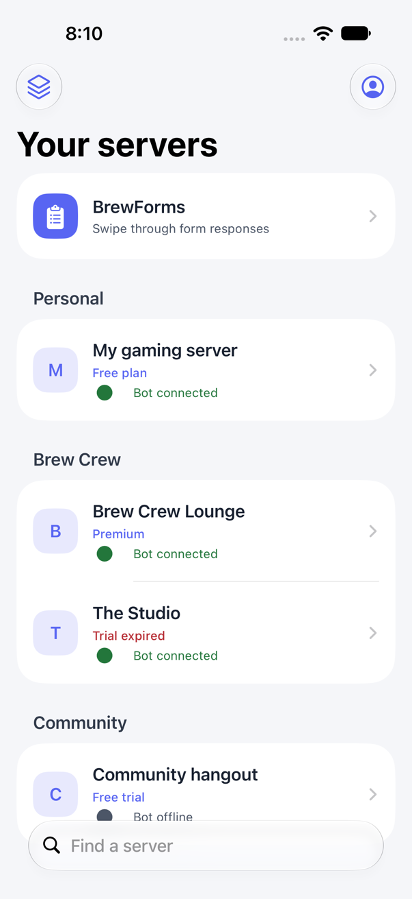
  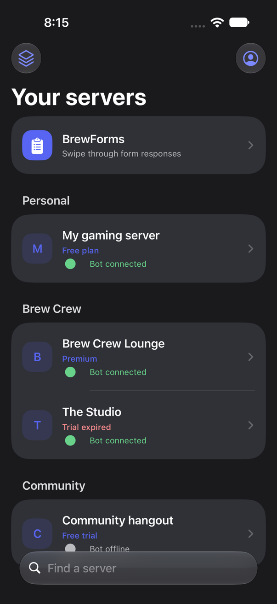
</Frame>

Select a server to open it. The server page has **Timer** (team servers), a player for **TikTok TTS** and one for **Twitch TTS**, a link to **TTS settings**, and **Brewlinks**.

<Frame>
  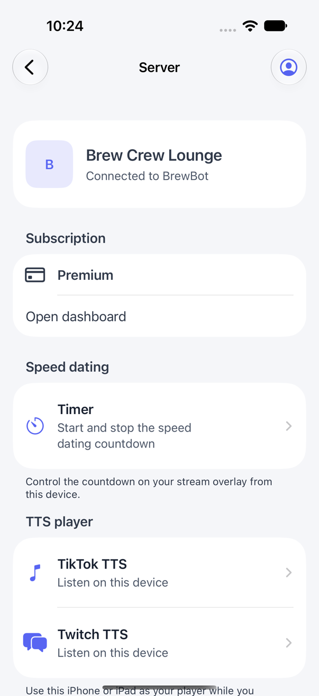
  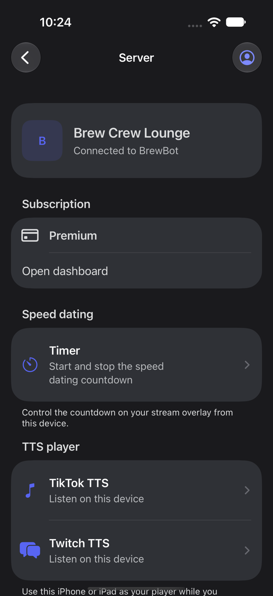
</Frame>

## Play TTS on your device

1. Open a server and select **TikTok TTS** or **Twitch TTS**.
2. Select **Start listening**.
3. Keep the app open. New messages play automatically.

The player shows the message playing now, your volume, the connection status, and the queue. **Recently played** shows up to five messages that finished playing in this player. Leaving the player clears it.

<Frame>
  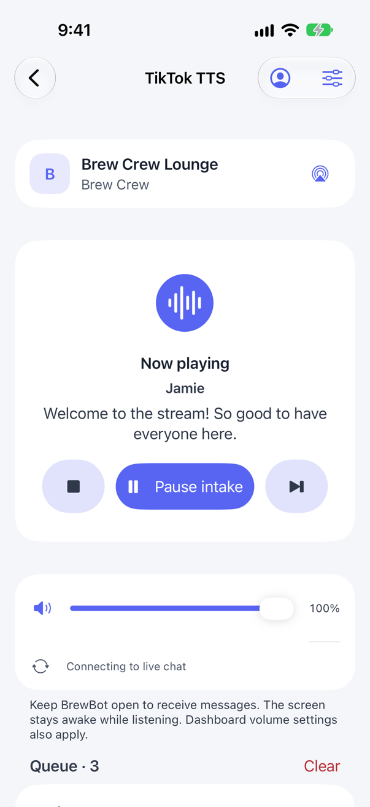
  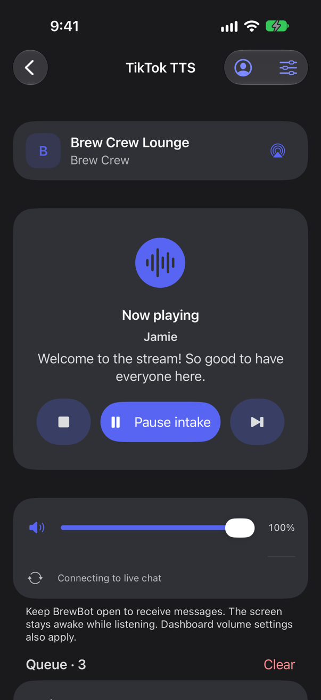
</Frame>

| Control | What it does |
| --- | --- |
| **Stop listening** (stop icon) | Stops listening on this device. |
| **Pause intake** | Finishes the current message, then stops taking new ones. Select **Resume** to continue. |
| **Skip** | Skips the message playing now. |
| **Mute** and volume | Changes the volume on this device only. [Volume](/features/volume) levels from the dashboard still apply. |
| **Audio output** | Sends sound to AirPlay, Bluetooth, or another output. |
| **Clear** | After you confirm, clears this platform's waiting messages for every player on the server. The message playing now finishes. |

Each platform has one queue per server, shared by the app, the OBS browser source, and the browser player. Each message plays on one player only, not on every device. Use only the player you want your stream to hear.

### Keep the player running

- Your screen stays awake while the player is listening.
- If you switch apps or lock your phone, the current message finishes. New messages wait until you come back to BrewBot.
- If a call or another app interrupts audio, or your headphones disconnect, the message playing now stops and is skipped, and the player pauses intake. Pausing from the lock screen does the same. Select **Resume** when you're ready.
- Going back to the server list, switching servers or platforms, or signing out stops the player. Rotating or folding your device doesn't.

<Note>
  For a whole stream, keep BrewBot open on a device that stays plugged in. The app doesn't keep playing new messages in the background.
</Note>

## Change TTS settings

Open **TTS settings** from the server page, or select **TTS settings** (the sliders icon) in a player. The app uses the same settings as **Live Tools > TTS Settings** in the dashboard. Changes apply to the server on all your devices.

<Frame>
  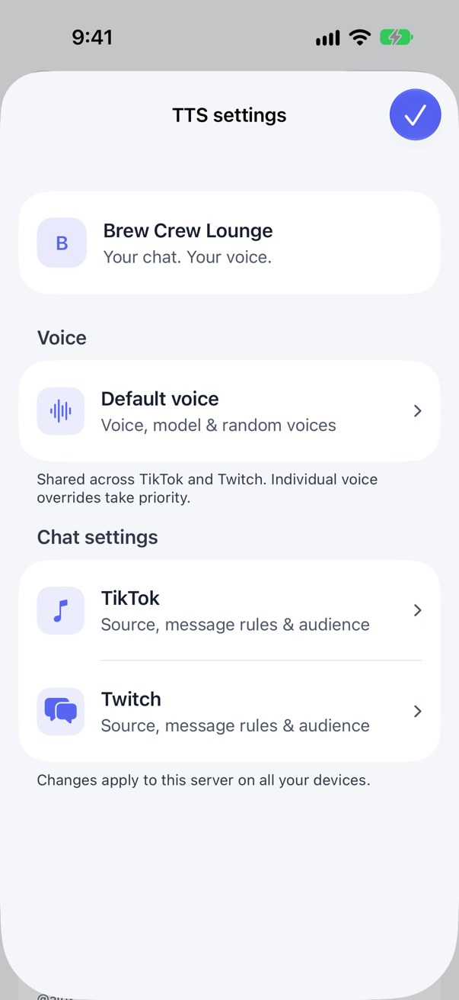
  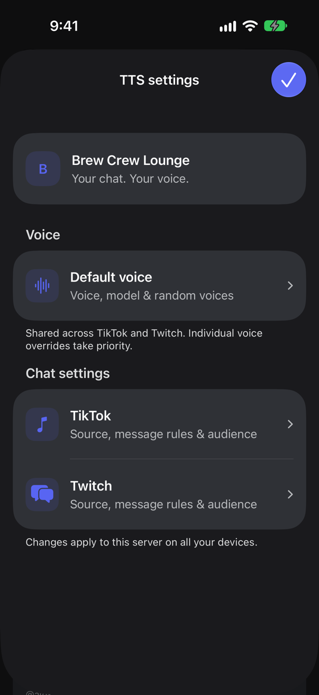
</Frame>

### Default voice

**Default voice** is shared by TikTok and Twitch.

- **Voice selection**: choose **One voice**, or **Random voices** to pick a voice for each message.
- **Voice**: with **One voice**, search the voice list by name or style.
- **Model**: choose **Multilingual v2** or **Eleven v3**. Eleven v3 supports [audio tags](/features/tts-audio-tags).

<Frame>
  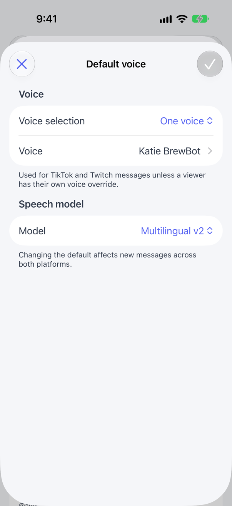
  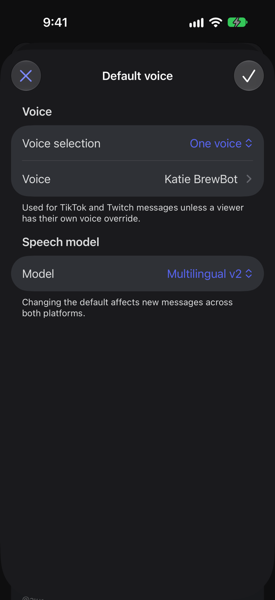
</Frame>

### TikTok and Twitch

Select **TikTok** or **Twitch** to change that platform's chat settings.

| Section | Settings |
| --- | --- |
| **Chat TTS** | **Enable chat TTS** and the **Source** to read from. |
| **Message rules** | **Read messages**: **Starting with //** or **All messages**. With **Starting with //**, turn on **Moderators can skip //** (TikTok) or **Staff & VIPs can skip //** (Twitch) to let those viewers skip the prefix. |
| **Audience** | **Who can speak**, **Allowed users**, and **Blocked users**. TikTok also has **Allow MVPs**. |
| **Heart Me** | TikTok only. **Announce Heart Me** and **Heart Me grants TTS access**. |
| **Voice overrides** | **Individual voices** gives a viewer their own voice on this platform. |

The source list shows your monitored TikTok channels or the Twitch sources you've added. Sources marked **(unavailable)** need attention in the dashboard. Select **Manage connections in dashboard** to add or reconnect one. You can't turn on **Enable chat TTS** until you choose an available source. The TikTok source is shared with your other live tools, so changing it here changes it for them too.

<Frame>
  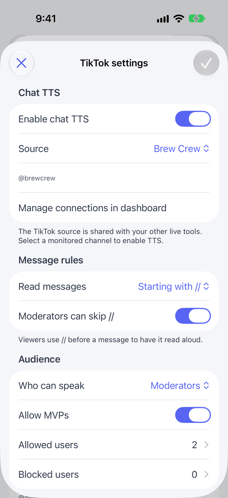
  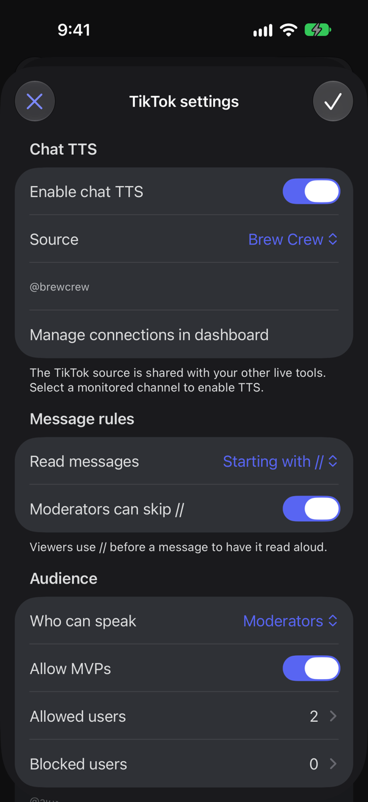
</Frame>

### Save your changes

Your changes aren't applied until you select **Save** (the check mark at the top right of the editor). If you close a screen with unsaved changes, the app asks before discarding them. If saving fails, your changes stay on screen so you can try again.

Opening settings from a player doesn't stop playback. Saving a new **Source**, or turning chat TTS on or off, stops this device's player for that platform. Select **Start listening** again afterward. Other changes apply to new messages without stopping the player.

## Run the speed dating timer

On a team server, select **Timer** on the server page to control the same countdown as **Start 3m** and **Reset** in the dashboard's [Speed Tracker](/features/speed-tracker#grid-header-and-controls). The countdown shows on your timer overlay and on every dashboard managing the server.

1. Under **Timer length**, pick **1m**, **2m**, **3m**, **5m**, or **10m**, or select **Custom** to choose any length up to 60 minutes. The app remembers your choice on this device.
2. Select **Start**.
3. Select **Stop timer** to end the countdown early, or **Restart** to start it again at the length you picked.

The countdown turns red in its last 30 seconds. If someone starts or stops the timer from the dashboard, or a [timer gift](/features/timer-gifts) extends it, the app shows the change within a few seconds.

<Frame>
  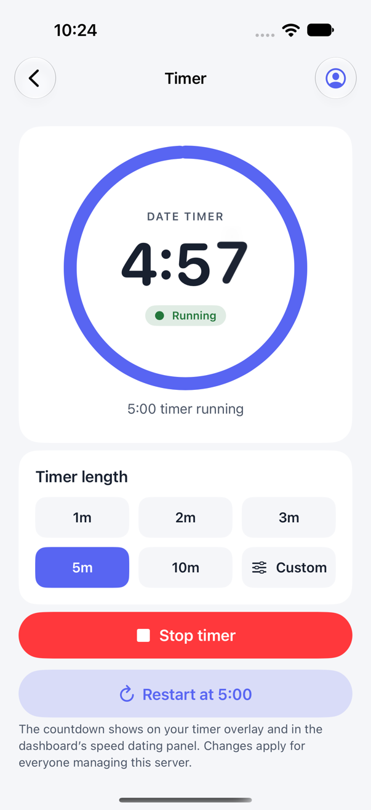
  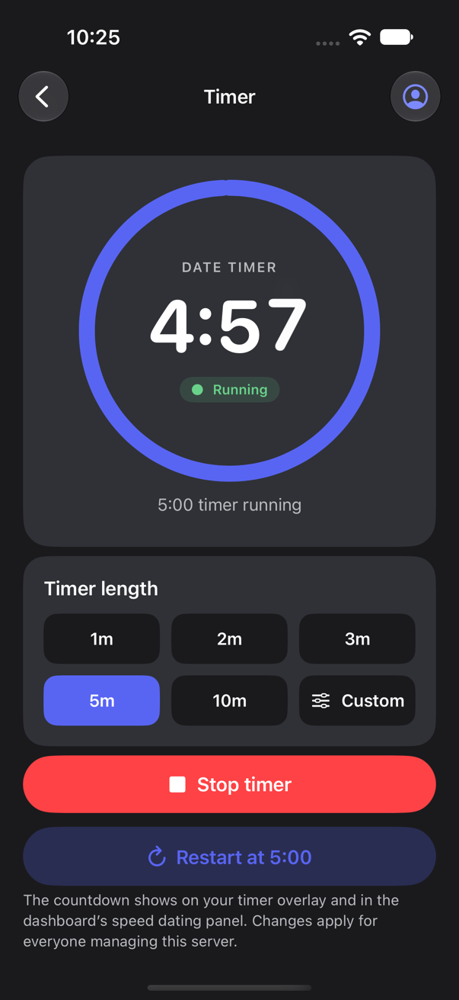
</Frame>

You need server admin access or the **Speed Dating** [feature permission](/getting-started/teams#feature-permissions). Timer title, overlay style, and end sound are set in **Speed Tracker > Settings > Grid & Timer** in the dashboard.

## Manage Brewlinks

Open **Brewlinks** from the server page to see the server's [Brewlinks](/features/brewlinks) pages, how many of the five you've used, and whether each page is **Live** or a **Draft**. The app uses the same pages as **Engagement > Brewlinks** in the dashboard.

- Select **New page** (the plus button) to create a draft page and open it.
- Select a page to see a preview of what visitors see.
- Swipe left on a page, or select **Delete page** at the bottom of a page, to delete it. Deleting removes the page and its links permanently.
- Touch and hold a live page to copy, share, or open its link.

### Share a page

On a page, turn on **Public page** to publish it, or off to hide it again. A page needs at least one link before you can publish it. Once it's live, use **Copy link**, **Share**, or **Open page**.

### Edit a page

Select **Edit** (the pencil at the top right) to change the page's title, subtitle, link, accent color, and links.

- **Link** sets the end of the page's address, such as `brewlinks.gg/your-slug`. It uses lowercase letters, numbers, and hyphens.
- **Accent color**: pick a color, or enter a hex value like `#5865f2`.
- **Add link** adds a link. Enter its title and address. If you leave out `https://`, the app adds it.
- To reorder links, select **Edit** in the **Links** header and drag them. Swipe left on a link to remove it.

The editor shows a preview as you type. Your changes aren't applied until you select **Save**, and the app asks before discarding unsaved changes.

### Change the logo

Tap the logo in the preview, or select **Choose a new logo**, and pick a photo. The new logo goes live right away, without saving. The app converts photos to a supported format and size for you. Select **Use server icon** to switch back to your Discord server icon.

## Read BrewForms responses

Select **BrewForms** at the top of **Your servers** to see your forms and how many responses each has. Forms are grouped by workspace and follow the workspace button: **All servers** shows your personal forms and every team's. You see the same forms as in the dashboard: the forms you created, or every team form if you're a Team Admin.

<Frame>
  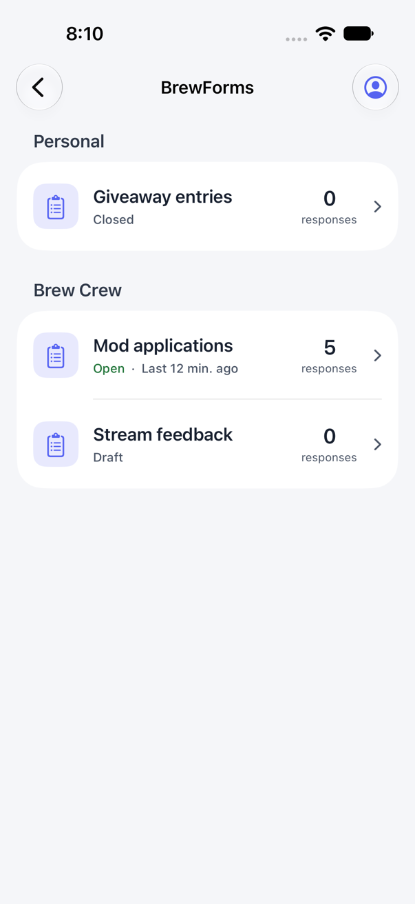
  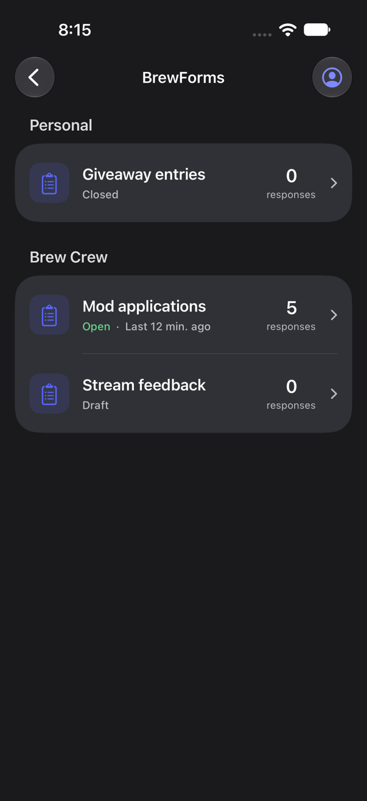
</Frame>

Select a form to read its responses as a stack of cards, newest first. Each card shows who answered (or **Anonymous response**), when, each answer, and the submission details: device and browser, how long they had the form open, and the site they came from.

- Swipe a card left or right, or select **Next** (the arrow), to go to the next response.
- Select **Previous** (the curved arrow) to bring back the last one.
- After the last response, select **Start over** to go back to the newest.

Swiping doesn't change or delete anything. Questions you removed from the form aren't shown. To edit forms, export responses, or delete them, use **Engagement > BrewForms** in the dashboard.

<Frame>
  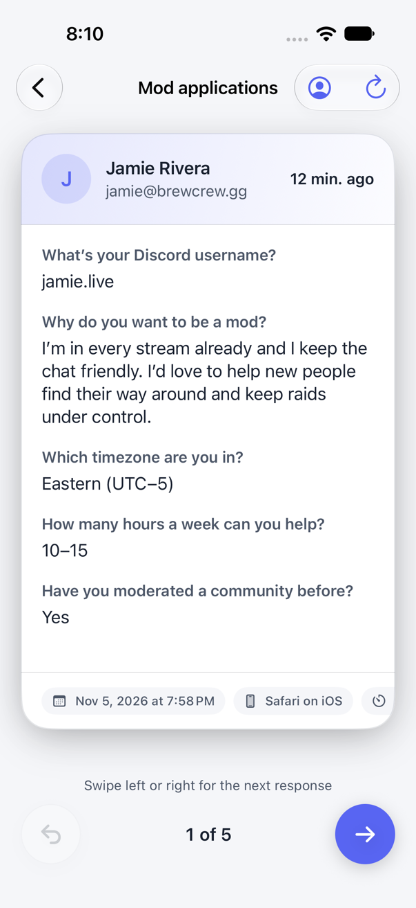
  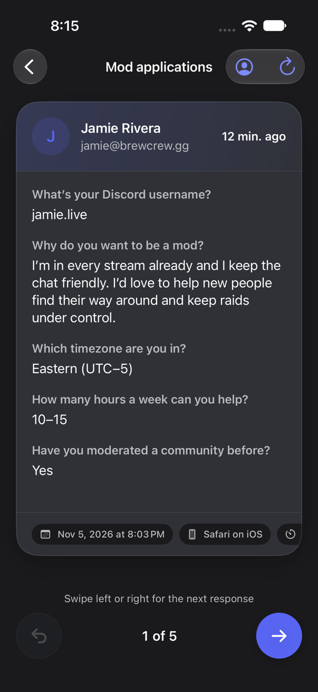
</Frame>

## Account and appearance

Select the profile button at the top right to open **Account**.

- **Manage profile** opens your profile, where you can change your name, email, and sign-in methods.
- **Appearance** sets the app to **System**, **Light**, or **Dark**. **System** follows your device setting.
- **Refresh servers** reloads your server list.
- **Sign out** stops playback on this device and signs you out.

<Frame>
  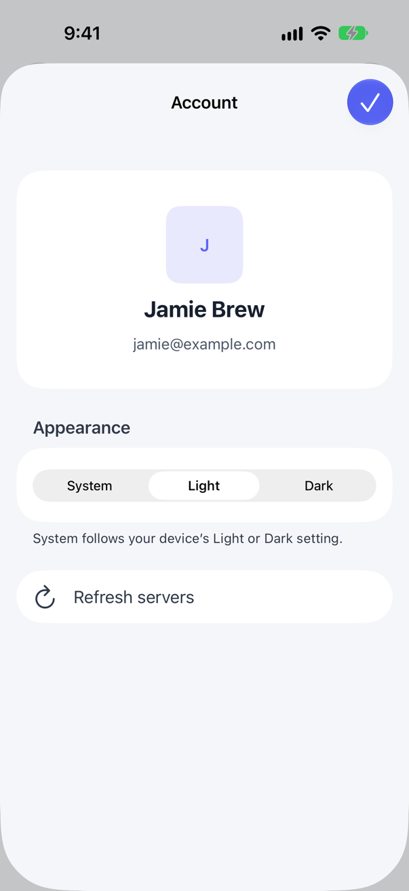
  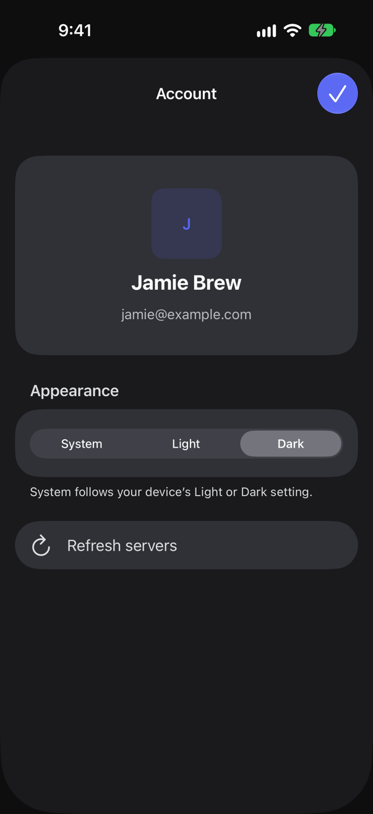
</Frame>

These screenshots use sample data. When you're signed in, **Account** also shows **Manage profile** and **Sign out**.

## iPad and iPhone Duo

On iPad, or on iPhone Duo when it's open, the app shows your servers beside the player or settings. In smaller windows, it shows one screen at a time. Rotating, folding, or resizing the app keeps the player running and keeps unsaved settings.

## Troubleshooting

| Problem | What to try |
| --- | --- |
| A server is missing | Check the workspace filter, then select **Refresh servers** in **Account**. The server needs to be in your dashboard first. |
| "Premium feature" or **Brewlinks requires Premium** | The server needs premium. See [Pricing and billing](/getting-started/billing). |
| "These settings aren't available for your account" or "You don't have access to this player" | You need access to the server in the dashboard. On team servers, TikTok TTS and **Default voice** also need server admin access or the **Speed Dating** feature permission. Ask a team admin to check your [feature permissions](/getting-started/teams#feature-permissions). If the player link changed, for example after **Regenerate link** in the dashboard, go back, reopen the player, and select **Start listening**. |
| "Chat TTS is turned off" | Open **TTS settings**, select the platform, and turn on **Enable chat TTS**. |
| Messages play on another device instead | Another player, such as an OBS browser source, is taking messages from the same queue. Close the players you don't need. |
| Playback stopped after a call or disconnected headphones | The interrupted message is skipped. Select **Resume** to continue with the next one. |
| No new messages after switching apps | Return to BrewBot. Waiting messages start again when the app is open. |
| **Timer** is missing | The timer is only on team servers with premium. On a personal server, use the dashboard. |
| "You need speed dating access" on **Timer** | Ask a team admin for the **Speed Dating** [feature permission](/getting-started/teams#feature-permissions). |
| A form is missing from **BrewForms** | Check the workspace button. You only see forms you created, or every team form if you're a Team Admin. Pull down on the list to refresh it. |
